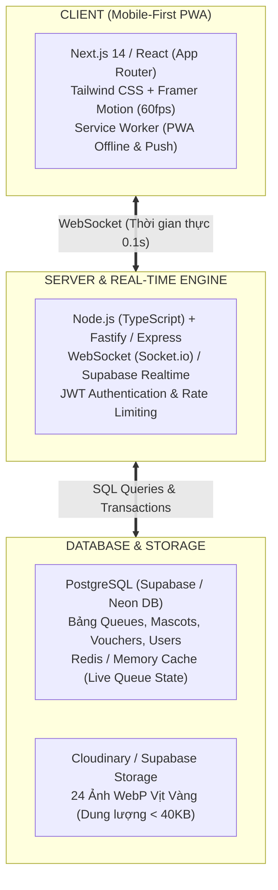
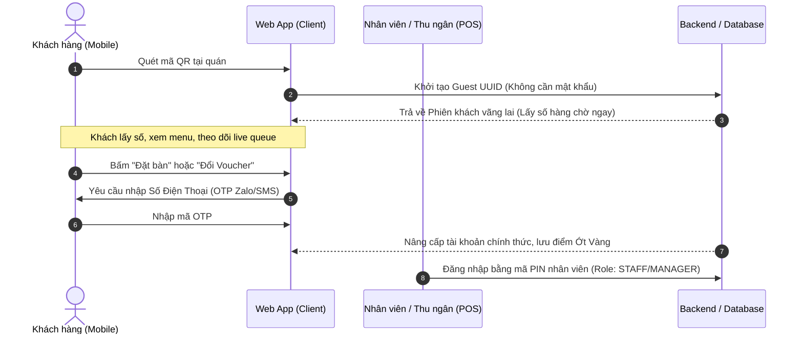

# KIẾN TRÚC KỸ THUẬT, BẢO MẬT & QUY TẮC VẬN HÀNH
## SPICY BOX SMART WEB APP (MOBILE-FIRST PWA)

---

## 1. CHỐT NGĂN XẾP CÔNG NGHỆ (TECH STACK & ARCHITECTURE)

* **Frontend:** **Next.js / React** kết hợp **Tailwind CSS**. Tối ưu hóa chuẩn PWA (Progressive Web App) để tạo icon ra màn hình chính điện thoại, hỗ trợ Web Vibration API và Web Audio API.
* **Backend:** **Node.js (TypeScript)** hoặc **Supabase**. Quản lý WebSocket để đẩy số thứ tự hàng chờ đến điện thoại khách hàng với độ trễ < 100ms.
* **Cơ sở dữ liệu:** **PostgreSQL** (chạy trên Supabase / Neon DB). Đảm bảo tính toàn vẹn dữ liệu giao dịch khi đổi voucher và mở hộp quà.
* **Lưu trữ ảnh:** 24 file ảnh chú Vịt Vàng cắt riêng lẻ đặt trong thư mục `assets/ducks/` định dạng PNG/WebP siêu nhẹ.

---

## 2. LUỒNG XÁC THỰC NGƯỜI DÙNG (AUTHENTICATION FLOW)

1. **Giai đoạn tiếp cận tức thì (Zero-Barrier Onboarding):**
   * Khách quét mã QR: Hệ sinh thái tự động cấp một `guest_uuid` lưu trong trình duyệt di động (`LocalStorage`).
   * Khách không bị chặn bởi form đăng ký rườm rà. Họ có thể lấy số thứ tự, xem menu, xem sổ vịt ngay lập tức.
2. **Giai đoạn định danh nâng cao (Progressive Profiling):**
   * Khi khách thực hiện hành động cần lưu trữ vĩnh viễn (như **Đặt bàn trước**, **Đổi voucher**, hoặc **Gom đủ bộ 6 chú vịt để nhận quà**): Hệ thống mới yêu cầu nhập Số Điện Thoại + OTP 4 số.
3. **Phân quyền Nhân viên (Staff / Manager Role-Based Access):**
   * Nhân viên thu ngân/quầy đón khách có mã PIN 4 số đăng nhập nhanh trên iPad hoặc điện thoại quầy.

---

## 3. QUY TẮC NGHIỆP VỤ BIÊN & CHỐNG GIAN LẬN (BUSINESS RULES & EDGE CASES)

### A. Chống lấy số hàng chờ ảo từ xa (Anti-Spoofing Queue)
* **Vấn đề:** Khách ở nhà tự ý bấm lấy số làm nghẽn hàng chờ của người đang đứng tại quán.
* **Giải pháp:**
  * Mã QR đặt trước cửa quán là **Dynamic QR (mã QR động thay đổi mã bảo mật mỗi 5 phút)** HOẶC kiểm tra tọa độ GPS của điện thoại nằm trong bán kính **100m quanh chi nhánh Spicy Box**.

### B. Xử lý trôi số hàng chờ (Missed Ticket Handling)
* Khi gọi đến số của khách (VD: `A-18`), nếu sau **3 lần chuông gọi** khách chưa có mặt:
  1. Trạng thái chuyển thành: `MISSED` (Quá lượt).
  2. Hệ thống gửi thông báo: *"Bạn bị lỡ lượt! Chỗ của bạn được giữ ưu tiên trong 10 phút. Vui lòng liên hệ nhân viên cửa quán để vào bàn kế tiếp"*.
  3. Bàn được tự động nhường cho số `A-19` tiếp theo để nhà hàng không bị trống bàn.

### C. Cơ chế chống gian lận mở hộp quà (Anti-Cheat Gacha System)
* Lượt mở hộp quà **không được cấp bởi phía Client (điện thoại)** mà phải được kích hoạt từ **Hệ thống POS** sau khi thanh toán hóa đơn.
* Mỗi hóa đơn thành công sẽ sinh một `gacha_token` (dùng 1 lần duy nhất). Điện thoại khách quét hoặc nhập mã hóa đơn để kích hoạt hoạt ảnh mở hộp.

### D. Cơ chế tái chế Sticker trùng (Duplicate Mascot Recycling)
* Nếu khách mở trúng chú vịt đã có (Ví dụ: 3 chú Vịt "Chào hỏi"):
  * Có nút **[ Tái chế 3 Sticker trùng ➔ Nhận 1 Lượt Mở Hộp Mới ]** HOẶC **[ Đổi 1 Sticker trùng ➔ Nhận 15 Ớt Vàng 🌶️ ]**.
  * Giúp khách không bị cảm giác hụt hẫng khi mở trùng.

---

## 4. BẢNG TRA CỨU 24 CHÚ VỊT VÀNG ĐÃ ĐƯỢC CẮT RỜI (ASSET MAPPING)

Tất cả 24 file ảnh PNG chất lượng cao đã được cắt vào thư mục: `assets/ducks/`

| STT | Mùa (Season) | Biểu cảm (Emotion) | Tên file vật lý | Độ hiếm (Rarity) | Tỷ lệ rơi (%) |
|:---:|---|---|---|:---:|:---:|
| 1 | 🎃 Halloween | Giận dỗi | `halloween_gian_doi.png` | Common | 15% |
| 2 | 🎃 Halloween | Chào hỏi | `halloween_chao_hoi.png` | Common | 30% |
| 3 | 🎃 Halloween | Mếu máo | `halloween_meu_mao.png` | Common | 15% |
| 4 | 🎃 Halloween | Chu mỏ | `halloween_chu_mo.png` | Rare | 15% |
| 5 | 🎃 Halloween | Ngạc nhiên | `halloween_ngac_nhien.png` | Legendary | 5% |
| 6 | 🎃 Halloween | Vui vẻ | `halloween_vui_ve.png` | Common | 20% |
| 7 | ❄️ Giáng Sinh | Giận dỗi | `christmas_gian_doi.png` | Common | 15% |
| 8 | ❄️ Giáng Sinh | Chào hỏi | `christmas_chao_hoi.png` | Common | 30% |
| 9 | ❄️ Giáng Sinh | Mếu máo | `christmas_meu_mao.png` | Common | 15% |
| 10 | ❄️ Giáng Sinh | Chu mỏ | `christmas_chu_mo.png` | Rare | 15% |
| 11 | ❄️ Giáng Sinh | Ngạc nhiên | `christmas_ngac_nhien.png` | Legendary | 5% |
| 12 | ❄️ Giáng Sinh | Vui vẻ | `christmas_vui_ve.png` | Common | 20% |
| 13 | 🥮 Trung Thu | Giận dỗi | `midautumn_gian_doi.png` | Common | 15% |
| 14 | 🥮 Trung Thu | Chào hỏi | `midautumn_chao_hoi.png` | Common | 30% |
| 15 | 🥮 Trung Thu | Mếu máo | `midautumn_meu_mao.png` | Common | 15% |
| 16 | 🥮 Trung Thu | Chu mỏ | `midautumn_chu_mo.png` | Rare | 15% |
| 17 | 🥮 Trung Thu | Ngạc nhiên | `midautumn_ngac_nhien.png` | Legendary | 5% |
| 18 | 🥮 Trung Thu | Vui vẻ | `midautumn_vui_ve.png` | Common | 20% |
| 19 | 🧧 Tết Nguyên Đán | Giận dỗi | `tet_gian_doi.png` | Common | 15% |
| 20 | 🧧 Tết Nguyên Đán | Chào hỏi | `tet_chao_hoi.png` | Common | 30% |
| 21 | 🧧 Tết Nguyên Đán | Mếu máo | `tet_meu_mao.png` | Common | 15% |
| 22 | 🧧 Tết Nguyên Đán | Chu mỏ | `tet_chu_mo.png` | Rare | 15% |
| 23 | 🧧 Tết Nguyên Đán | Ngạc nhiên | `tet_ngac_nhien.png` | Legendary | 5% |
| 24 | 🧧 Tết Nguyên Đán | Vui vẻ | `tet_vui_ve.png` | Common | 20% |
