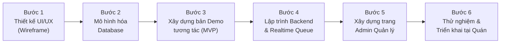

# ĐẶC TẢ HỆ THỐNG & KẾ HOẠCH TRIỂN KHAI
## ỨNG DỤNG ĐẶT BÀN, HÀNG CHỜ THỜI GIAN THỰC & BỘ SƯU TẬP LINH VẬT SỐ THEO MÙA (STORE DESIGN THINKING)

---

## PHẦN 1: BẢNG TỔNG HỢP VÀ CỤ THỂ HOÁ CÁC TÍNH NĂNG

Hệ thống được chia làm 2 phân hệ độc lập nhưng đồng bộ dữ liệu thời gian thực (Real-time):

### A. PHÂN HỆ KHÁCH HÀNG (Customer Web App - Tối ưu cho Điện thoại di động)
Khách hàng không cần cài ứng dụng từ App Store/CH Play, chỉ cần quét mã QR tại bàn, trên fanpage hoặc trước cửa quán là mở được ngay.

| Nhóm chức năng | Tên tính năng cụ thể | Mô tả chi tiết trải nghiệm người dùng |
|---|---|---|
| **1. Đặt bàn trước (Reservation)** | • Chọn lịch & khung giờ • Chọn khu vực ngồi • Nhận mã đặt bàn (QR Code) | • Khách chọn ngày, giờ đến, số lượng người lớn/trẻ em. • Chọn vị trí: Trong nhà, ngoài trời, phòng riêng, gần cửa sổ. • Nhập tên, số điện thoại, ghi chú đặc biệt (sinh nhật, dị ứng đồ ăn). • Nhận vé đặt bàn điện tử kèm mã QR để xuất trình khi đến quán. |
| **2. Theo dõi hàng chờ Live (Live Queue)** | • Lấy số thứ tự online • Màn hình Live Tracking • Cảnh báo sắp đến lượt | • Quét mã QR tại cửa quán để lấy số thứ tự điện tử. • Hiển thị số đang phục vụ và số của khách theo thời gian thực (*"Phía trước bạn còn 2 lượt"*). • Dự báo thời gian chờ ước tính (VD: ~15 phút). • Khi còn 1 lượt: Màn hình đổi màu vàng + rung báo hiệu chuẩn bị quay lại quầy. Khi đến lượt: Màn hình chuyển xanh sáng rực rỡ báo *"Mời bạn vào bàn!"*. |
| **3. Mở hộp quà bí ẩn (Gacha Mascot)** | • Mở hộp sau khi ghé quán • Animation xé hộp quà • Nhận Sticker Vịt ngẫu nhiên | • Sau mỗi lần thanh toán hoặc hoàn thành lượt ngồi tại quán, tài khoản nhận 1 lượt mở hộp quà. • Hiệu ứng mở hộp quà 3D lắc lư vui mắt. • Mở ra 1 trong 6 biểu cảm chú Vịt của mùa đang kích hoạt (Halloween, Giáng Sinh, Tết, Trung Thu). |
| **4. Sổ sưu tập Sticker Vịt (Digital Album)** | • Bộ sưu tập 4 mùa x 6 biểu cảm • Hiệu ứng bóng đen bí ẩn • Khoe bộ sưu tập | • Giao diện dạng lưới (Grid) 6 ô biểu cảm: *Giận dỗi, Chào hỏi, Mếu máo, Chu mỏ, Ngạc nhiên, Vui vẻ*. • Sticker nào đã mở thì sáng rõ màu 3D; sticker chưa có hiển thị bóng đen (Silhouette) có dấu chấm hỏi `?` thôi thúc mở tiếp. • Xem lại được các mùa trước (Lưu trữ vĩnh viễn trong tài khoản). • Nút chia sẻ ảnh chú Vịt lên mạng xã hội kèm lời chúc dễ thương. |
| **5. Tích điểm & Đổi Voucher (Loyalty)** | • Tích điểm theo chi tiêu • Chợ Voucher ưu đãi • Mã giảm giá 1 lần (Single-use QR) | • Tự động tích điểm khi có hóa đơn (VD: 10.000 VNĐ = 1 điểm). • Đổi điểm lấy các voucher: Giảm 20k, Tặng bánh ngọt, Miễn phí up-size. • Voucher có thời hạn sử dụng và mã QR riêng để đưa thu ngân quét áp dụng. |

---

### B. PHÂN HỆ QUẢN LÝ & NHÂN VIÊN (Admin / Staff Dashboard)
Giao diện quản trị vận hành trên iPad quầy thu ngân, Laptop hoặc điện thoại của quản lý.

| Nhóm chức năng | Tên tính năng cụ thể | Mô tả chi tiết vai trò của Quản lý |
|---|---|---|
| **1. Cấu hình Mùa & Linh vật (Season Control)** | • Chuyển đổi mùa 1-Click • Cài đặt tỷ lệ rớt (Drop Rate) • Cấu hình phần thưởng trọn bộ | • Menu chọn mùa: *Halloween / Giáng Sinh / Tết / Trung Thu / Thường* ➔ Toàn bộ giao diện khách hàng và kho quà Gacha lập tức đổi chủ đề. • Tự chỉnh độ hiếm: Vịt Chào hỏi (35%), Vịt Vui vẻ (30%), Vịt Ngạc nhiên (5% - Siêu hiếm). • Cài quà tặng đặc biệt khi khách gom đủ bộ 6/6 biểu cảm của mùa. |
| **2. Bảng điều phối hàng chờ (Queue Dispatcher)** | • Nút "Gọi số tiếp theo" • Nút "Bỏ lượt / Vắng mặt" • Bật/Tắt tiếp nhận hàng chờ | • Nhân viên bấm 1 nút để gọi lượt tiếp theo ➔ Hệ thống tự động push thông báo đến điện thoại của khách đó. • Quản lý danh sách bàn đang trống để chỉ định khách vào bàn 2 người, 4 người hoặc bàn lớn. • Tạm dừng tiếp nhận hàng chờ khi quán quá tải giờ cao điểm. |
| **3. Quản lý Đặt bàn (Booking Manager)** | • Xem lịch theo ngày/ca • Duyệt / Từ chối đặt bàn • Khóa khung giờ kín chỗ | • Hiển thị danh sách khách đặt bàn theo ca Trưa / Chiều / Tối. • Chủ động khóa các khung giờ cao điểm đã hết bàn để khách không đặt được nữa. |
| **4. Quản lý & Quét Voucher (POS Scanner)** | • Tạo mã Voucher mới • Quét QR voucher tại quầy | • Tạo chương trình khuyến mãi linh hoạt theo sự kiện. • Camera quét trực tiếp mã QR trên điện thoại khách để trừ voucher và tích điểm tự động. |

---

## PHẦN 2: LỘ TRÌNH 6 BƯỚC TRIỂN KHAI CHI TIẾT (ROADMAP)

### Bước 1: Thiết kế giao diện người dùng (UI/UX & Wireframe)
* **Thời gian dự kiến:** 3 - 5 ngày.
* **Mục tiêu:**
  * Vẽ khung màn hình trên điện thoại (Mobile Wireframe) cho 4 tab chính: Trang chủ (Đặt bàn + Hàng chờ), Hộp quà Gacha, Sổ Sticker Vịt, Kho Voucher.
  * Thiết kế Bộ Theme 4 Mùa (Màu sắc, icon, hiệu ứng tuyết rơi/lá rơi).
  * Kiểm thử cảm xúc người dùng (Đảm bảo thao tác nhanh dưới 3 lần chạm).

### Bước 2: Thiết kế Kiến trúc Dữ liệu (Database Architecture)
* **Thời gian dự kiến:** 2 - 3 ngày.
* **Mục tiêu:**
  * Tạo các bảng dữ liệu chuẩn:
    * `Users` (Khách hàng, số điện thoại, điểm tích lũy).
    * `Reservations` (Thông tin đặt bàn, ngày giờ, số khách, trạng thái).
    * `Queues` (Số thứ tự, giờ lấy số, trạng thái: Chờ / Đang phục vụ / Đã xong).
    * `Mascots` (Danh mục 24 chú vịt: mùa, tên biểu cảm, hình ảnh, độ hiếm).
    * `UserInventory` (Kho sticker khách đã sở hữu, ngày mở được).
    * `Vouchers` & `UserVouchers` (Danh mục mã giảm giá).

### Bước 3: Xây dựng Bản thử nghiệm tương tác (Clickable MVP Frontend)
* **Thời gian dự kiến:** 4 - 6 ngày.
* **Mục tiêu:**
  * Lập trình giao diện HTML5/CSS3/JavaScript mượt mà chạy trên trình duyệt.
  * Tích hợp hình ảnh chú Vịt Vàng thật vào giao diện.
  * Tạo hiệu ứng mở hộp quà và chuyển đổi thử 4 mùa trực tiếp.

### Bước 4: Lập trình Backend & Tính năng Thời gian thực (Real-time Engine)
* **Thời gian dự kiến:** 5 - 7 ngày.
* **Công nghệ khuyên dùng:** Node.js (Express) + Socket.io (hoặc Firebase Realtime) + PostgreSQL/MongoDB.
* **Mục tiêu:**
  * Xử lý WebSocket để khi nhân viên bấm "Gọi số" ở Admin thì điện thoại của khách nhảy số ngay lập tức trong 0.1 giây.
  * Thuật toán bốc thăm ngẫu nhiên (RNG) cho hộp quà sticker dựa trên tỉ lệ % do quán cài đặt.

### Bước 5: Hoàn thiện Bảng Quản trị (Admin Dashboard)
* **Thời gian dự kiến:** 4 - 5 ngày.
* **Mục tiêu:**
  * Màn hình cảm ứng tối ưu cho nhân viên: Chạm gọi số, chạm xác nhận bàn, quét mã voucher bằng camera.
  * Trang cài đặt cho quản lý: Nút gạt chuyển mùa, cài đặt số lượng bàn và khung giờ mở cửa.

### Bước 6: Kiểm thử nội bộ & Triển khai thực tế tại quán (Go-Live)
* **Thời gian dự kiến:** 3 - 5 ngày.
* **Mục tiêu:**
  * Đặt mã QR tại từng bàn và quầy đón khách trước cửa quán.
  * Đào tạo nhân viên cách gọi số và quét mã cho khách.
  * Theo dõi phản hồi của khách hàng trong tuần đầu tiên để tối ưu hóa.
