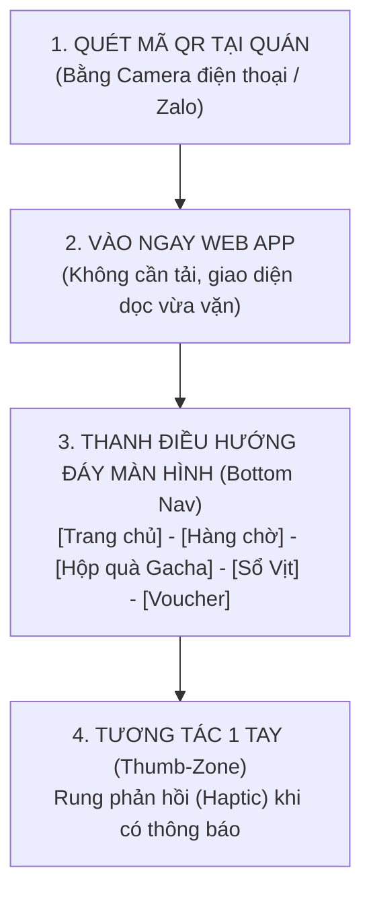
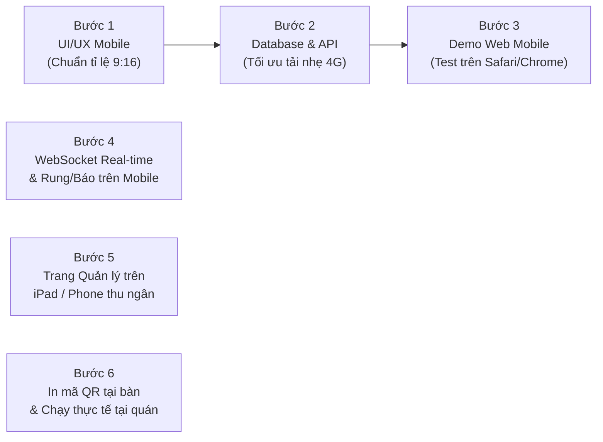

# ĐẶC TẢ HỆ THỐNG & KẾ HOẠCH TRIỂN KHAI
## WEB APP DI ĐỘNG (MOBILE-FIRST / PWA): ĐẶT BÀN, HÀNG CHỜ LIVE & BỘ SƯU TẬP LINH VẬT SỐ THEO MÙA

> **TIÊU CHUẨN THIẾT KẾ CỐT LÕI: MOBILE-FIRST & PWA (PROGRESSIVE WEB APP)**  
> Ứng dụng được tối ưu hóa 100% cho màn hình điện thoại thông minh (iOS & Android). Khách hàng chỉ cần quét mã QR tại bàn/quầy là mở tức thì trên trình duyệt di động (Safari/Chrome), không cần tải app rườm rà nhưng vẫn có trải nghiệm mượt mà, hỗ trợ cài đặt icon ra màn hình chính và nhận thông báo rung khi đến lượt.

---

## PHẦN 1: ĐẶC TẢ TÍNH NĂNG TỐI ƯU HOÀN TOÀN CHO ĐIỆN THOẠI DI ĐỘNG

### A. PHÂN HỆ KHÁCH HÀNG (Mobile Customer Web App)

| Nhóm chức năng | Tối ưu hóa đặc thù cho Điện thoại di động (Mobile UX) | Chi tiết tính năng |
|---|---|---|
| **1. Tiếp cận tức thì (Instant QR Access & PWA)** | • Không cần tạo tài khoản mật khẩu phức tạp. • Hỗ trợ nút *"Thêm vào màn hình chính"* (Add to Home Screen) tạo icon chú Vịt như app thật. • Dung lượng siêu nhẹ (< 2MB) tải trong 1 giây qua 4G. | • Quét mã QR tại bàn, quầy đón khách hoặc từ link mạng xã hội để vào thẳng app. • Tự động ghi nhớ thiết bị/SĐT để không phải đăng nhập lại mỗi lần ghé quán. |
| **2. Đặt bàn nhanh (Mobile Booking)** | • Form cuộn mượt (Scroll Wheel) chọn ngày & giờ. • Tối ưu bàn phím số tự động bật khi nhập SĐT. • Lưu vé đặt chỗ trực tiếp vào Apple Wallet / Google Wallet hoặc chụp màn hình. | • Chọn nhanh số lượng khách (1-2 người, 3-4 người, nhóm đông). • Chọn khu vực ngồi trực quan bằng hình minh họa. • Nhận mã QR vé đặt chỗ hiển thị rõ nét trên màn hình để nhân viên quét. |
| **3. Theo dõi hàng chờ Live (Mobile Live Queue)** | • Chế độ toàn màn hình không tắt đèn (Wake Lock API). • Rung điện thoại (Vibration API) và đổi màu màn hình khi đến lượt. • Thông báo đẩy (Web Push Notification) ngay cả khi khách khóa màn hình hoặc mở tab khác. | • Khách lấy số xong có thể cất máy vào túi hoặc đi dạo xung quanh. • Màn hình hiển thị số to, rõ: *"Còn 2 số nữa đến bạn (khoảng 10 phút)"*. • Khi đến lượt: Điện thoại rung liên tục + màn hình chuyển xanh sáng kèm âm thanh chuông báo. |
| **4. Mở hộp quà Gacha Vịt (Interactive Mobile Gacha)** | • Tương tác chạm: Chạm ngón tay để xé ruy-băng / lắc hộp quà. • Rung nhẹ từng nhịp khi mở hộp (Tạo cảm giác như mở đồ chơi thật). • Hiệu ứng ánh sáng hào quang bung ra chú Vịt 3D. | • Sau khi thanh toán, khách chạm mở hộp quà. • Tự động sinh thẻ ảnh chú Vịt vuông chuẩn tỉ lệ 9:16 để đăng ngay lên Story Instagram/Facebook/TikTok chỉ với 1 nút chạm. |
| **5. Sổ sưu tập Vịt Vàng (Sticker Album 4 Mùa)** | • Thiết kế dạng thẻ bài (Card Grid) 2 cột x 3 dòng vừa khít màn hình điện thoại (không cần cuộn nhiều). • Vuốt ngang (Swipe) mượt mà để chuyển đổi qua lại giữa các mùa. • Chạm vào từng chú Vịt để nghe tiếng kêu "Cạp cạp" vui nhộn và xem thông tin ngày nhận. | • 4 Mùa: Halloween (Bí ngô), Giáng Sinh (Khăn len), Trung Thu (Đèn lồng), Tết (Áo dài). • 6 Biểu cảm: *Giận dỗi, Chào hỏi, Mếu máo, Chu mỏ, Ngạc nhiên, Vui vẻ*. • Chú vịt chưa mở hiện bóng đen `?`. Thanh tiến độ: *"Bạn đã sưu tập 4/6 chú vịt Halloween"*. |
| **6. Kho Voucher & Ví ưu đãi** | • Hiển thị mã vạch / mã QR tự động tăng độ sáng màn hình lên mức cao nhất để máy quét POS quét dễ dàng. • Đếm ngược thời gian hết hạn voucher rõ ràng. | • Khách đưa điện thoại cho thu ngân quét trong 1 giây để trừ tiền. • Đổi điểm tích lũy lấy voucher ngay trên điện thoại. |

---

### B. PHÂN HỆ QUẢN LÝ TỐI ƯU CHO DI ĐỘNG (Mobile / Tablet Staff Dashboard)
Nhân viên phục vụ và quản lý không cần ngồi máy tính cồng kềnh, có thể cầm **điện thoại hoặc iPad mini** đi lại linh hoạt trong quán:

1. **Giao diện nút bấm siêu to (Big Touch Targets):**
   * Nút **[ GỌI SỐ TIẾP THEO ]** thiết kế to bản ở góc dưới màn hình, nhân viên chỉ cần 1 cú chạm ngón cái là gọi khách.
2. **Quét mã Voucher & Mã Đặt bàn bằng chính Camera điện thoại nhân viên:**
   * Tích hợp máy quét QR thẳng vào trình duyệt web, không cần mua máy quét chuyên dụng.
3. **Chuyển đổi Mùa linh hoạt (Season Switcher):**
   * Quản lý gạt nút chuyển mùa trên điện thoại bất cứ lúc nào: Lập tức toàn bộ điện thoại khách hàng đổi theme và đổi bộ quà tặng Vịt.

---

## PHẦN 2: NGUYÊN TẮC THIẾT KẾ GIAO DIỆN DI ĐỘNG (MOBILE UX RULES)

1. **Vùng ngón tay cái (Thumb-Zone Design):**
   * Mọi nút bấm quan trọng đều nằm ở 1/3 dưới cùng của màn hình.
   * Menu chính sử dụng **Bottom Navigation Bar (Thanh điều hướng dưới đáy)** gồm 5 icon:
     `[ 🏠 Trang chủ ]  [ ⏳ Hàng chờ ]  [ 🎁 Mở quà ]  [ 🦆 Sổ Vịt ]  [ 🎟️ Voucher ]`
2. **Tối ưu tốc độ tải hình ảnh:**
   * 24 hình ảnh chú Vịt Vàng 3D được nén định dạng hiện đại **WebP** (dung lượng siêu nhẹ chỉ ~40KB/ảnh nhưng độ sắc nét cực cao).
   * Khách dù dùng mạng 4G yếu tại quán vẫn tải hình ảnh tức thì.
3. **Phản hồi xúc giác (Haptic Feedback):**
   * Khi chạm vào nút hoặc khi mở hộp quà trúng Vịt hiếm, điện thoại rung nhẹ theo nhịp tạo cảm giác hào hứng, thích thú.

---

## PHẦN 3: LỘ TRÌNH TRIỂN KHAI THEO CHUẨN MOBILE

